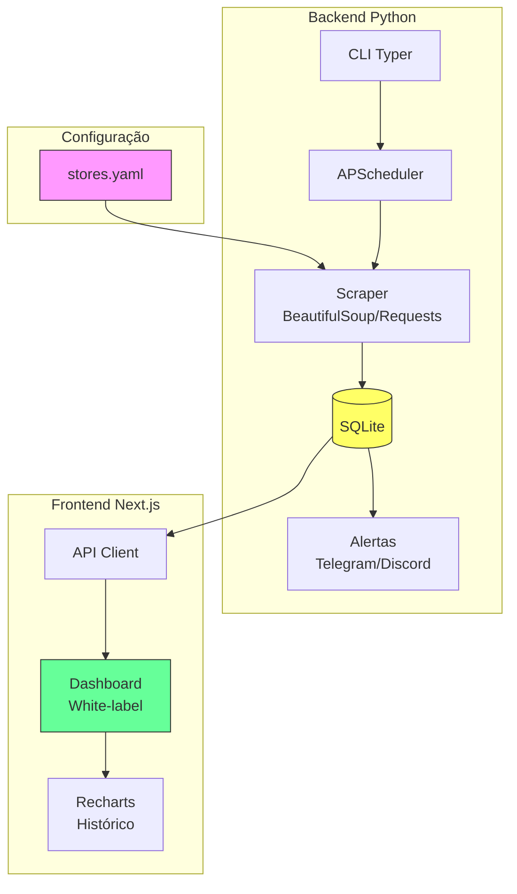

# PriceHawk

Monitor de preços white-label com alertas via Telegram e Discord.

## Visão Geral

O PriceHawk é um sistema de monitoramento de preços que permite acompanhar produtos de qualquer loja configurável via YAML. Quando detectada uma queda de preço acima do threshold configurado, alertas são enviados via Telegram e Discord.

## Arquitetura



## Funcionalidades

- ✅ Monitoramento de preços de lojas configuráveis via YAML
- ✅ Suporte a lojas API (JSON) e HTML (BeautifulSoup)
- ✅ Histórico de preços armazenado em SQLite
- ✅ Alertas automáticos por queda de preço (Telegram + Discord webhook)
- ✅ Dashboard Next.js com gráfico de histórico por produto
- ✅ Temas e cores configuráveis (white-label)
- ✅ Agendamento com APScheduler
- ✅ Docker Compose para deploy
- ✅ Testes automatizados com pytest

## Instalação

### Pré-requisitos

- Python 3.12+
- Node.js 20+
- Docker (opcional)

### Backend

```bash
# Clone o repositório
git clone https://github.com/ErickEloy/pricehawk.git
cd pricehawk

# Crie ambiente virtual
python -m venv .venv
.venv\Scripts\activate  # Windows
# source .venv/bin/activate  # Linux/Mac

# Instale dependências
pip install -e .[dev]

# Configure variáveis de ambiente
cp .env.example .env
# Edite .env com suas credenciais

# Inicialize banco
pricehawk init-db

# Verifique preços (dry-run)
pricehawk check --dry-run

# Inicie monitoramento
pricehawk daemon
```

### Frontend

```bash
cd frontend
npm install
npm run dev
```

Acesse http://localhost:3000

## Configuração de Lojas

Edite `config/stores.yaml`:

```yaml
stores:
  - name: "FakeStore API"
    base_url: "https://fakestoreapi.com"
    price_selector: "price"
    name_selector: "title"
    products:
      - external_id: "1"
        url: "https://fakestoreapi.com/products/1"
```

## Docker

```bash
docker-compose up -d
```

## Testes

```bash
pytest tests/ -v
```

## Estrutura do Projeto

```
pricehawk/
├── pricehawk/           # Backend Python
│   ├── __init__.py
│   ├── cli.py          # Interface CLI
│   ├── config.py       # Configurações
│   ├── database.py     # Modelos SQLAlchemy
│   ├── scraper.py      # Scraping de preços
│   ├── scheduler.py    # Agendamento
│   ├── alerts.py       # Telegram/Discord
│   └── api_client.py   # Cliente API
├── frontend/           # Dashboard Next.js
│   ├── src/app/        # App Router
│   └── package.json
├── config/             # Configurações YAML
├── tests/              # Testes pytest
├── docker-compose.yml
└── README.md
```

## Roadmap

- [ ] API REST completa com FastAPI
- [ ] Autenticação de usuários
- [ ] Multi-tenant (clientes white-label)
- [ ] Exportação de dados (CSV/Excel)
- [ ] Notificações por email
- [ ] Webhooks personalizáveis
- [ ] Painel administrativo
- [ ] Análise de tendências

## Licença

MIT

---

*Generated with [Claude Code](https://claude.com/claude-code)*
