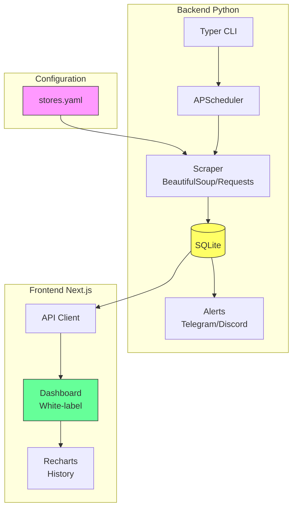

# PriceHawk

White-label price monitoring system with Telegram and Discord alerts.

## Overview

PriceHawk is a price tracking system that allows monitoring products from any configurable store via YAML. When a price drop above the configured threshold is detected, alerts are sent via Telegram and Discord.

## Architecture



## Features

- ✅ Price monitoring for YAML-configurable stores
- ✅ Support for API stores (JSON) and HTML (BeautifulSoup)
- ✅ Price history stored in SQLite
- ✅ Automatic alerts on price drops (Telegram + Discord webhook)
- ✅ Next.js dashboard with product price history charts
- ✅ Configurable themes and colors (white-label)
- ✅ Scheduling with APScheduler
- ✅ Docker Compose for deployment
- ✅ Automated tests with pytest

## Installation

### Prerequisites

- Python 3.12+
- Node.js 20+
- Docker (optional)

### Backend

```bash
# Clone repository
git clone https://github.com/ErickEloy/pricehawk.git
cd pricehawk

# Create virtual environment
python -m venv .venv
.venv\Scripts\activate  # Windows
# source .venv/bin/activate  # Linux/Mac

# Install dependencies
pip install -e .[dev]

# Configure environment variables
cp .env.example .env
# Edit .env with your credentials

# Initialize database
pricehawk init-db

# Check prices (dry-run)
pricehawk check --dry-run

# Start monitoring
pricehawk daemon
```

### Frontend

```bash
cd frontend
npm install
npm run dev
```

Access http://localhost:3000

## Store Configuration

Edit `config/stores.yaml`:

```yaml
stores:
  - name: "FakeStore API"
    base_url: "https://fakestoreapi.com"
    price_selector: "price"
    name_selector: "title"
    products:
      - external_id: "1"
        url: "https://fakestoreapi.com/products/1"
```

## Docker

```bash
docker-compose up -d
```

## Tests

```bash
pytest tests/ -v
```

## Project Structure

```
pricehawk/
├── pricehawk/           # Python backend
│   ├── __init__.py
│   ├── cli.py          # CLI interface
│   ├── config.py       # Settings
│   ├── database.py     # SQLAlchemy models
│   ├── scraper.py      # Price scraping
│   ├── scheduler.py    # Scheduling
│   ├── alerts.py       # Telegram/Discord
│   └── api_client.py   # API client
├── frontend/           # Next.js dashboard
│   ├── src/app/        # App Router
│   └── package.json
├── config/             # YAML configurations
├── tests/              # pytest tests
├── docker-compose.yml
└── README.md
```

## Roadmap

- [ ] Complete REST API with FastAPI
- [ ] User authentication
- [ ] Multi-tenant (white-label clients)
- [ ] Data export (CSV/Excel)
- [ ] Email notifications
- [ ] Custom webhooks
- [ ] Admin panel
- [ ] Trend analysis

## License

MIT

---

*Generated with [Claude Code](https://claude.com/claude-code)*
